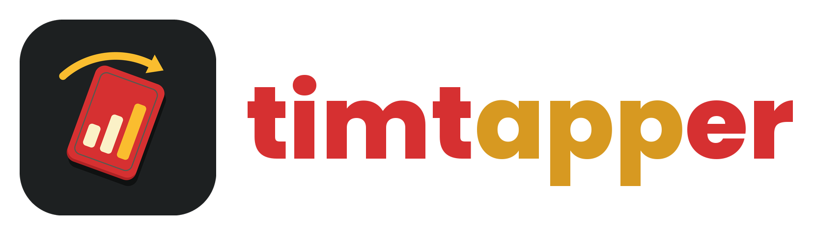
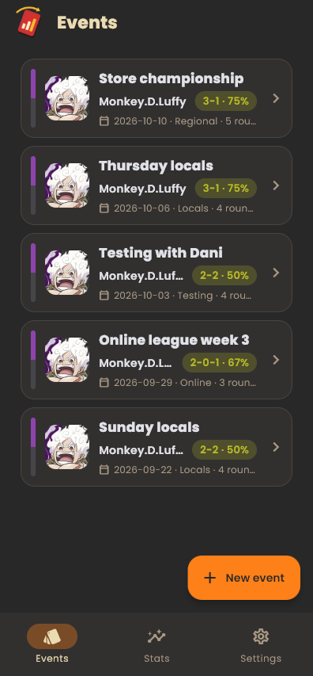
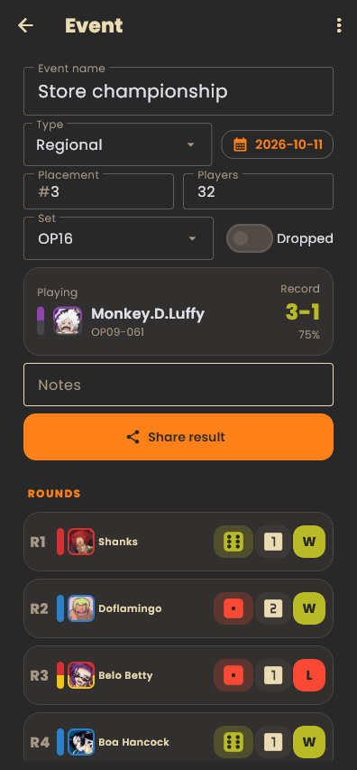
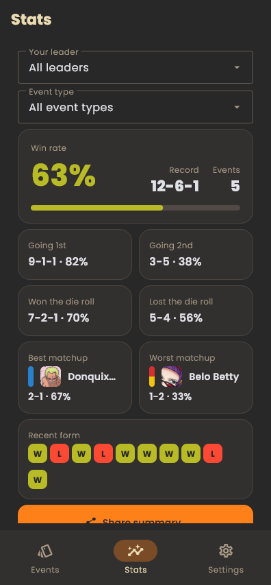
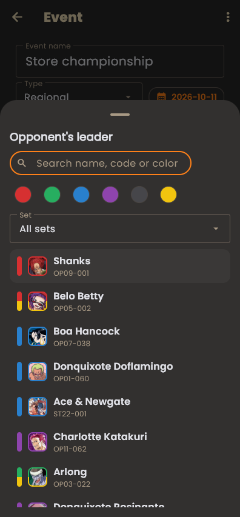
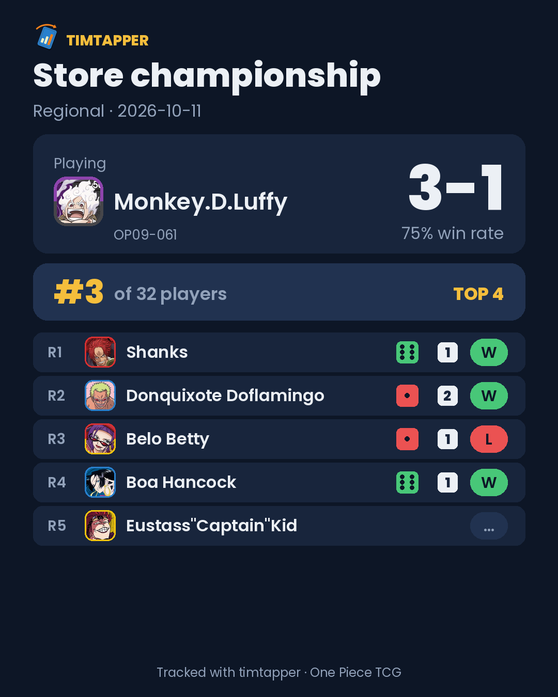
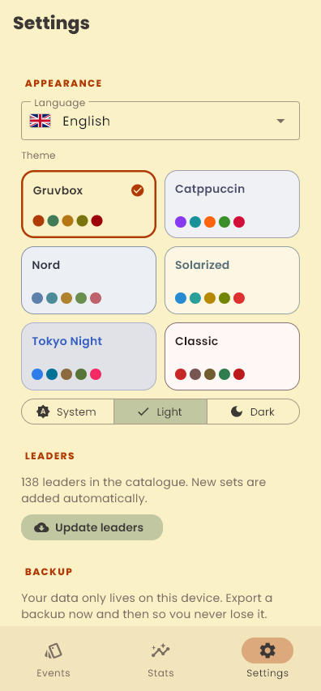
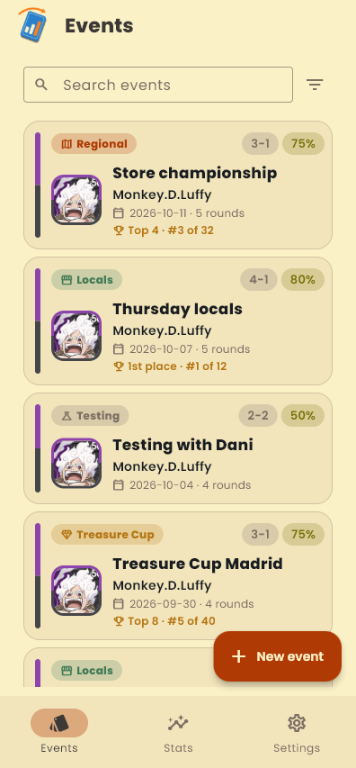

[//]: # ( ---------------------------------------------------------------------- )
[//]: # (+ Authors: 	Ran# <ran.hash@proton.me> )
[//]: # (+ Created: 	2026/10/11 15:48:36.910831 )
[//]: # (+ Revised: 	2026/10/13 22:03:51.502334 )
[//]: # ( ---------------------------------------------------------------------- )

# timtapper

<p align="center"></p>

<p align="center">
  <b>Match tracker for the One Piece Trading Card Game.</b><br>
  Log every round, see your matchups, share your results. Android, Windows and the browser, fully offline.
</p>

<p align="center">
  
  
  
  
</p>

<p align="center">
  <a href="https://github.com/Ran-n/timtapper/releases/latest"></a>
  <a href="https://ran-n.github.io/timtapper/"></a>
</p>

<p align="center"><sub>
  Mirrors:
  <a href="https://codeberg.org/ran-n/timtapper/releases/latest"></a>
  <a href="https://gitlab.com/Ran-n/timtapper/-/releases/permalink/latest"></a>
  · browser:
  <a href="https://ran-n.codeberg.page/timtapper/"></a>
</sub></p>

No accounts, no server, no sync: your events live on your device, and a JSON backup moves them to another install.
In the browser they stay in that browser's storage; export a backup now and then.

## Features

- **Every event type**: locals, Store Championships, Treasure Cups, regionals and the rest of the official calendar,
  plus testing sessions. Track your leader, set and final standing ("Top 4 · #3 of 32").
- **Fast round logging**: Swiss, best-of-3 top cut and byes. Tap the die roll, turn order or result to cycle it; no
  forms.
- **Stats that matter**: win rate, going 1st vs 2nd, die roll, best and worst matchups and a full matchup table,
  filtered by leader, event type and set.
- **Share cards**: event, matchup and summary images ready for the share sheet.
- **Always-current leaders**: 138 leaders up to OP17 bundled with portraits; new sets download on their own.
- **Themes and languages**: 8 themes (Gruvbox, Catppuccin, Dracula, Nord, Rosé Pine…) in light and dark; English,
  Español, Galego.

<p align="center">
  
  
  
</p>

Every feature in detail: [docs/FEATURES.md](docs/FEATURES.md).

## Quick start

Requires Python ≥ 3.14 and [uv](https://docs.astral.sh/uv/).

```sh
uv sync
uv run flet run
```

Android builds, tests, screenshots and the leader catalogue: [docs/DEVELOPMENT.md](docs/DEVELOPMENT.md).

## Privacy

timtapper collects nothing: your data stays on your device, and the app only downloads public card data. See
[PRIVACY.md](PRIVACY.md).

## Disclaimer

timtapper is a fan-made tool, not affiliated with or endorsed by Bandai, Eiichiro Oda or Shueisha. Leader portraits
are small crops of the official card art, which belongs to its owners. The bye jester is adapted from Microsoft's
[Fluent Emoji](https://github.com/microsoft/fluentui-emoji) (MIT).

## License

[PayBack License (PBL)](LICENSE). Contributions welcome: see [CONTRIBUTING.md](CONTRIBUTING.md).
